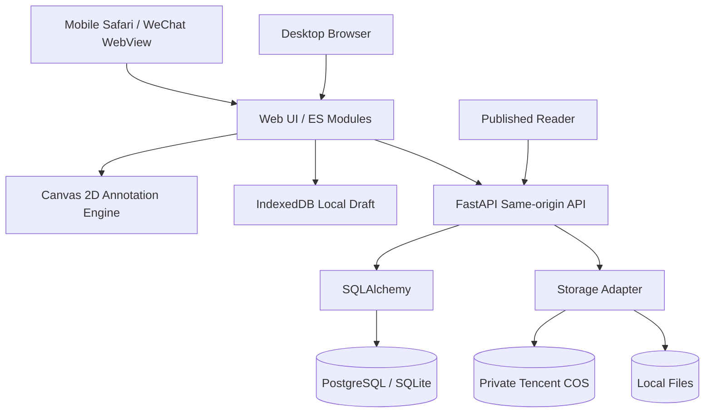

# Guide Studio · 技术架构与方案选型 V1

## 1. 决策记录（ADR）

| 模块 | V1 选择 | 对比方案 | 选择原因 / 权衡 |
|---|---|---|---|
| 客户端 | 原生 ES Modules + CSS + Canvas | React/Vue + Konva/Fabric | 空仓库首版无需打包，0 前端依赖、极速启动；代价是编辑状态和组件维护成本后期更高，可按边界迁移到 React |
| 截图标注 | 原生 Canvas 2D + JSON | DOM/SVG 标注、服务端 Pillow | 设备本地计算，可控制 PNG 导出、高级标注、体积小；放弃现成图形库，先实现 8 类基础图元 |
| 本地存储 | IndexedDB | localStorage | 可保存大图 dataURL 和完整草稿，避免同步每一步请求；仍需要定期云端备份 |
| API | Python FastAPI | Node/Fastify、Django | 低样板代码、类型校验清楚、内建 OpenAPI，现有 Python 技术栈容易运维 |
| ORM | SQLAlchemy 2.x | 手写 SQL | PostgreSQL 与 SQLite 双适配，模型可演进 |
| 数据库 | PostgreSQL 正式 / SQLite 本地 | MongoDB | 事务、权限和业务关系天然适合关系库；步骤 JSON 作为原子文档存储 |
| 对象存储 | 私有 COS，开发用本地磁盘 | 图片直接入数据库 | 利用现有腾讯云资产，不膨胀 SQL 数据；COS 设置最小权限 |
| 登录 | scrypt 密码 + HMAC 签名 HttpOnly Cookie | JWT、微信 OAuth | 首版部署少依赖、同源容易管理；未来扩展 SSO/OAuth 和会话撤销表 |
| 发布 | 编辑模型 + 独立 `GuidePublication` 快照 | 更新 Guide 即公开 | 草稿修改不会污染或中断旧版公开链接 |
| 部署 | Docker + FastAPI + PostgreSQL + HTTPS 反向代理 | Serverless | 成本可控、方便 NAS/服务器；后续可分离 CDN 和 API |

### 为什么不在第一版直接使用 React + Konva？

产品目前核心风险是触屏操作流是否顺手，不是技术生态复杂度。原生技术已经覆盖拖放、Canvas、DOM、响应式布局和离线草稿，省去了依赖安装和打包维护。不过设计上仍将 `web/canvas.js` 划成可替换的绘图模块，等图层、文本富排版、自动检测区域等需求明确后再迁移成熟图形编辑框架。此选型是**首版阶段决策**，不主张长期坚持零依赖。

## 2. 系统分层



- 原始截图在内存及浏览器持久化草稿中编辑；只有显式云端保存才上传源文件。
- 作者的图片读取路径要求同一工作空间权限；匿名访问只能读取出现在公开快照中的 `kind=export` 资产。
- 公开页取 `GuidePublication.steps`，不返回源图 ID、源图片链接或标注对象。
- 当修改公开教程时，Guide 最新草稿与 Publication 旧快照并存；再次发布才替换快照，slug 保持不变。

## 3. 数据与权限边界

Membership(role = owner/editor/reviewer) 连接 User 与 Workspace。Project 属于 Workspace；FAQ、Guide 属于 Project；Asset 属于 Workspace。作者每次读写都先核验 Membership 再核验资源所有权，防止按 ID 枚举横向访问。编辑 API 传入 `revision`，乐观锁冲突返回 409。

当前 reviewer 只拥有发布权限，编辑者具有编辑及发布权限。未来增加审批流可调整为编辑只能提交 review，reviewer 审核后发布。

## 4. 图片生命周期与资产隔离

```
选择图片 → dataURL 保存至 IndexedDB (无需云端)
          → 云端保存：上传 source asset (私有)
标注对象 → JSON 存于 Guide.steps[] (不压平)
发布      → 浏览器 Canvas 将原图+标注+遮挡压平成 PNG
          → 上传 export asset (私有桶对象)
          → 修改 Guide 中 publicAssetId → 发布快照
匿名用户  → API 判定 export 对象确实在某一 Published Snapshot 引用 → 输出图片
```

**隐私遮挡**使用不可逆实色覆盖，避免模糊半径不足导致识别；公开图片不能提供任何图层数据。源图仍留存在私有素材空间，只允许授权者访问，且源图可能包含隐私，应提供后续销毁/保留策略。

## 5. 重要的工程权衡

- **云端首版采用服务端中转图片**：对小团队流量足够，避免浏览器泄露密钥。规模扩大后改 COS STS 临时凭据 + 前端直传 + 上传回调验证，减少服务器带宽。
- **SQLite 仅为开发便利**：正式数据使用 PostgreSQL；上线应引入 Alembic migrations，V1 使用 `create_all` 只在初次建表时生效，不能自动迁移变更。
- **浏览器保留 dataURL**：编辑门槛低，但高分辨率/上百张图片可能快速耗尽配额；后续转 IndexedDB Blob 分片并增加空间使用仪表盘。
- **同源 Cookie**：便于 WebApp；后续微信小程序 Native WebView 跨域登录需要进一步设计 token/session 交换和白名单。
- **安全生产发布**：应用还需要代理层限速、统一错误日志、监控、数据库备份、COS CORS/生命周期策略，以及微信/手机真机测试。
