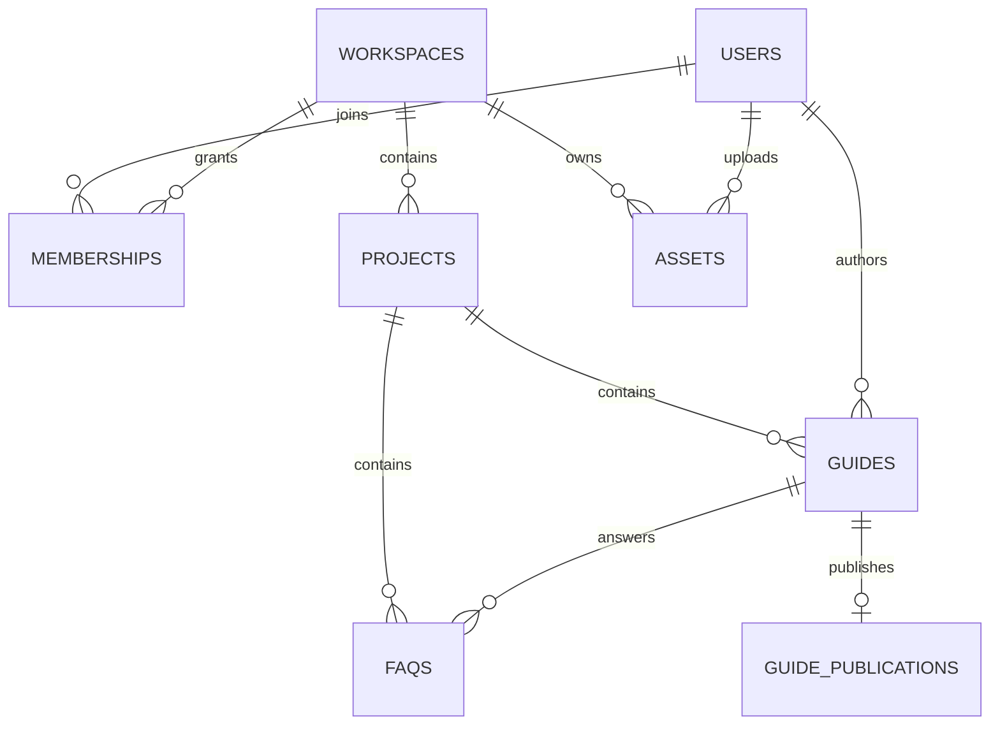

# Guide Studio · 数据模型与接口 V1

## 1. ER 关系图



实际定义集中于 `server/db.py`；各字段均通过 SQLAlchemy 初始化（V1 使用 `create_all`，升级前需要补 Alembic）。

## 2. 主要实体与字段

| 表 | 关键字段 | 约束 / 语义 |
|---|---|---|
| `users` | id(UUID 字符串 PK), email(unique), display_name, password_hash, created_at | scrypt，明文密码不落库 |
| `workspaces` | id, name, slug(unique), created_at | 企业/协作团队的租户边界 |
| `memberships` | id, user_id, workspace_id, role | unique(workspace_id,user_id)，角色 owner/editor/reviewer |
| `projects` | id, workspace_id, name, slug, description | unique(workspace_id,slug)，言序是首个项目 |
| `guides` | id, project_id, author_id, title, description, category, audience, status, slug(unique), revision, steps(JSON), created_at, updated_at, published_at | 完整可编辑草稿；revision 用于防覆盖 |
| `guide_publications` | guide_id(PK/FK), title, description, category, audience, steps(JSON), published_at | 公开稳定快照，不允许包含原始素材 ID |
| `faqs` | id, project_id, question, category, audience, guide_id(nullable), created_at | 多问题可引用同一教程 |
| `assets` | id, workspace_id, uploaded_by, object_key(unique), mime_type, size_bytes, kind, ready, created_at | `kind=source/export`，私有桶存储 |

### `Guide.steps` JSON 示例

```json
[
  {
    "id": "step-uuid",
    "description": "进入会议详情，点击导出按钮。",
    "sourceAssetId": "private-source-asset-uuid",
    "publicAssetId": "flattened-export-uuid",
    "annotations": [
      {"type":"circle","x":0.68,"y":0.15,"w":0.25,"h":0.1,"color":"#E5484D","width":0.006},
      {"type":"arrow","x":0.4,"y":0.5,"x2":0.7,"y2":0.25,"color":"#E5484D","width":0.006},
      {"type":"text","x":0.3,"y":0.2,"text":"点这里","fontSize":0.037,"color":"#E5484D"},
      {"type":"mask","x":0.12,"y":0.1,"w":0.4,"h":0.05}
    ]
  }
]
```

所有图形位置均为 **0–1 归一化坐标**。预览可缩放，正式 PNG 输出以原图像素尺寸绘制。`pen.points` 是坐标点数组。`number.text` 为序号。`mask` 是不可逆实色覆盖而非可取消的图片滤镜。前端本地额外保存 `imageData`（base64 dataURL）和 `imageUrl`；它们不进入服务端 Guide JSON。

### 为什么不拆成 `guide_steps` 表？

V1 以编辑与发布一整篇教程为原子操作，一个教程通常几十步以内，JSON 易于一次提交、乐观锁并发检查和发布快照。若未来需要步骤级复用、独立版本与大规模内容分析，迁移到 `guide_steps` / `guide_step_versions` 明细表更合适。

## 3. REST API 契约

| Method | Path | 权限 | 含义 |
|---|---|---|---|
| GET | `/api/health` | public | 健康检查 |
| POST | `/api/auth/login` | public | 邮箱+密码登录，签发 HttpOnly cookie |
| POST | `/api/auth/logout` | cookie | 清理 Cookie |
| GET | `/api/auth/me` | login | 当前用户与工作空间 |
| GET | `/api/projects` | login | 列出有权限项目 |
| POST | `/api/projects` | owner | 创建项目 |
| GET | `/api/guides?project_id=...` | workspace member | 列出项目教程 |
| POST | `/api/guides` | owner/editor | 新建教程 |
| GET | `/api/guides/{id}` | workspace member | 读取源草稿与标注 |
| PUT | `/api/guides/{id}` | owner/editor + revision | 完整覆盖草稿，revision + 1 |
| POST | `/api/guides/{id}/publish` | owner/editor/reviewer | 校验导出图、替换发布快照 |
| DELETE | `/api/guides/{id}` | owner | 删除教程及其发布快照 |
| GET | `/api/faqs?project_id=...` | workspace member | FAQ 列表 |
| POST | `/api/faqs` | owner/editor | 创建/关联 FAQ |
| DELETE | `/api/faqs/{id}` | owner/editor | 删除 FAQ |
| POST | `/api/members` | owner | 加入协作用户 |
| POST | `/api/assets?workspace_id=...&kind=source\|export` | owner/editor | 上传 PNG/JPEG/WebP，最大20MB |
| GET | `/api/assets/{id}/content` | member or public export snapshot | 受控图片读取 |
| GET | `/api/public/{slug}` | public | 匿名读取发布快照（过滤敏感字段） |
| GET | `/g/{slug}` | public | 响应式阅读页 |
| GET | `/api/docs` | 运行中 API 文档 | FastAPI OpenAPI（生产可关闭） |

请求内容类型：JSON，图片上传例外为原始 image/png / image/jpeg / image/webp 二进制。接口错误统一 HTTP 401（未登录）、403（无权限）、404（隐藏无权限对象）、409（revision 冲突）、413（文件过大）、415（媒体类型非法）、422（验证错误）。

### 典型云端保存

```http
POST /api/guides
Content-Type: application/json
Cookie: gs_session=...

{
  "projectId":"project-uuid",
  "title":"如何导出会议议程",
  "category":"会议管理",
  "audience":"会议组织者",
  "steps":[{"id":"step-uuid","description":"点击导出","sourceAssetId":"asset-uuid","annotations":[]}]
}
```

编辑时 `PUT /api/guides/{id}` 必须携带服务端上次返回的 revision。若收到 HTTP 409，当前客户端应该保留未提交的本地草稿，提醒刷新对比；不要直接覆盖别人的更新。

### 匿名教程响应示例

```json
{
  "title": "如何导出会议议程",
  "description": "",
  "category": "会议管理",
  "audience": "会议组织者",
  "steps": [
    {"id":"step-uuid", "description":"点击导出", "imageUrl":"/api/assets/export-uuid/content"}
  ],
  "updatedAt": "2026-10-11T20:00:00+00:00"
}
```

**绝不可在匿名 API 中包含** `sourceAssetId`、`annotations`、`imageData`、管理员用户名或完整存储桶 key。

## 4. 后续扩展与迁移约定

- 增加 `faq_aliases`、`faq_events` 实现同义问题聚合与效果统计。
- 增加 `guide_revisions` 保存历史内容和版本回滚；当前只有一份最新草稿和一份公开快照。
- 增加 `tasks`、`task_assignees`、`reviews` 支持多人分工、审核和发布治理。
- 增加 `members.invitation_token_hash` 和一次性邀请机制，替代 API 手工设置初始密码。
- 增加软删除、回收站、对象引用计数及素材生命周期清理任务。
- 所有新增表必须包含租户归属或可从外键可靠追溯到 Workspace；始终先授权再读取。
